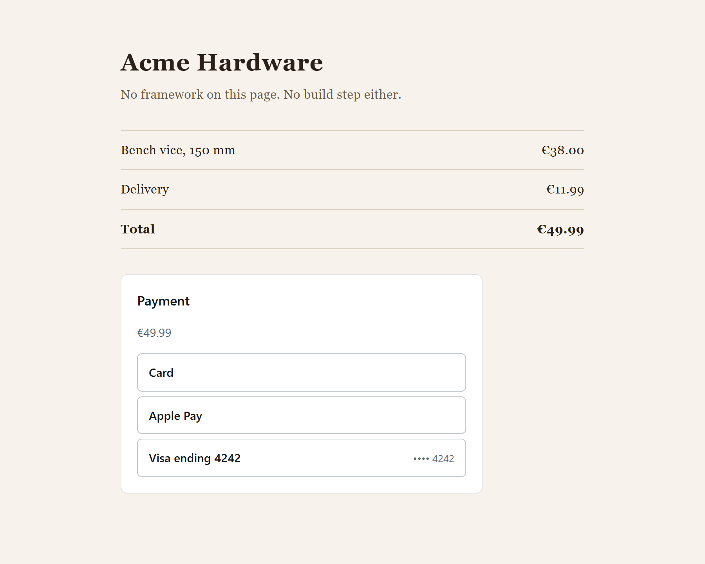

# checkout-embed

An embeddable checkout widget. A shop adds one script tag and gets a payment form inside an
empty `div` on its own page.

**[Live demo](https://nikolaimelni.github.io/checkout-embed/)**: pay, get declined, pass a 3DS
check, or switch on a stylesheet that tries to break the widget. GitHub Pages only serves
static files, so the demo runs the real widget and SDK against a payment provider simulated
in the browser, on test data. The project itself is complete: the provider is a real server,
and it runs locally together with two shop pages and the browser tests.



The widget renders React into a shadow root, so the shop's CSS cannot reach it. Card fields
and the 3DS page live in iframes on the payment provider's origin, and the widget never sees
a card number. A 1.6 kB loader queues the shop's calls until the bundle arrives, and the
payment state machine has no DOM at all, so it is tested in plain Node.

```
packages/contracts   Zod schemas shared by both sides, plus the protocol version
packages/core        payment state machine
packages/widget      the UI, React in a shadow root
packages/sdk         loader and public API
apps/mock-psp        a fake payment provider: Express, SQLite, 3DS, signed webhooks
apps/sandbox         the live demo and Storybook
apps/demo-host-*     two shop pages, plain HTML and Next.js
```

To run it locally you need Node 24 and pnpm through corepack:

```bash
corepack enable && pnpm install && pnpm build
pnpm dev    # the same demo as on Pages, at localhost:5173
```

The full setup is three processes, one terminal each:

```bash
pnpm --filter @checkout-embed/mock-psp dev          # provider on :4000, API docs at /docs
pnpm --filter @checkout-embed/demo-host-plain dev   # plain HTML shop on :5174
pnpm --filter @checkout-embed/demo-host-next dev    # Next.js shop on :5175
```

On the plain shop the amount comes from the query string and picks what the provider does:
`?amount=1051` declines, `?amount=1003` asks for 3DS, `?amount=1099` never settles, anything
else succeeds. `pnpm e2e` starts all three on its own and walks those paths in Chromium, and
`pnpm lint && pnpm typecheck && pnpm test` covers the rest.

Why a shadow root is not enough on its own: [docs/shadow-dom-in-react.md](docs/shadow-dom-in-react.md).

MIT
